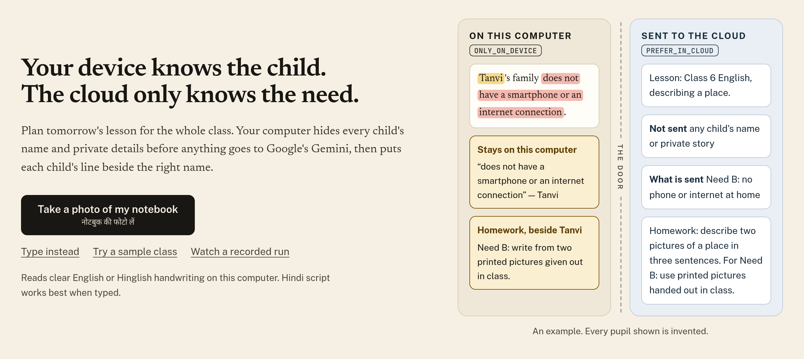

# Staffroom

**Most hybrid apps decide where the work runs. Staffroom decides what each model is allowed to know.**

**Your device knows the child. The cloud only knows the need.**

Built for **#BuildHybridAI 2026 (Best Web/Chrome)** · Live app: **https://staffroom-hybrid-8a71.web.app** · Licence: [Apache-2.0](LICENSE)

A teacher photographs a page of her notebook. Her computer keeps every notebook sentence on the device, turns what it finds into lettered needs from a fixed list like `"away on Tuesdays"`, and sends **zero notebook prose** to the cloud to write tomorrow's lesson. When the lesson comes back, her computer puts each child's name beside the line written for them.



## Structural boundary (`src/core/boundary.ts`)

Instead of relying on redaction to hold back every private sentence, the lesson request is built from a single typed allowlist in [`src/core/boundary.ts`](src/core/boundary.ts) (`FIXED_CONSTRAINT_LINES`, `LEARNING_CATALOGUE`, `CLASSROOM_ACTION_CATALOGUE`, `WEEKDAY_ENUM`) plus validated lesson metadata (`klass`, `subject`, `topic`, `minutes`, `language`, `lastTime`).

- **Zero notebook prose crosses:** Every sentence of the notebook stays on the device. Gemini Nano may propose a constraint kind, never author outgoing cloud text.
- **Catalogue vs deliberate custom wording:** Non-fixed kinds (`health`, `contact`, `other`) offer curated zero-reason classroom actions (`CLASSROOM_ACTION_CATALOGUE`). Teacher-typed custom wording requires passing the exit gate plus ticking **"Send my own wording (not from the catalogue)."** and is labelled **Your own words**.
- **Required send-time verification:** [`src/ai/draft.ts`](src/ai/draft.ts) (`writeDraft`, `writeMaterials`, `labelReceipt`) requires a boundary guard (`LessonBoundaryGuard`, `MaterialsBoundaryPayload`, `LabelBoundaryPayload`), rebuilds the exact expected request via `assertLessonBoundary` / `assertMaterialsBoundary` / `assertLabelBoundary`, and refuses to send if even one character differs. Non-lesson compose modes (`plan`, `parents`, `handover`) are inactive and fail closed.
- **No-Nano browsers:** *"Without Gemini Nano, this browser uses rules only to find needs — it finds fewer needs, and still sends nothing from your notebook."*

For the sample class, the exact outgoing text is **824** characters with **0** notebook sentences (`50` characters shorter than the `submitted-fallback` pass-through build) and keeps identical `12 / 12` lesson & materials coverage ([`before-after-sample.md`](docs/evals/boundary/before-after-sample.md)).

## Try it

- **Any browser, no setup.** Open **https://staffroom-hybrid-8a71.web.app** and click **Watch a recorded run** (labelled **Watch a recorded run with Gemini Nano** on browsers without an on-device model). It replays a real Chrome 158 and Gemini Nano run, step by step.
- **Chrome 158+ with Gemini Nano.** Requires desktop Chrome 158 or newer with Built-in AI ready — see Chrome's [Prompt API hardware & disk requirements](https://developer.chrome.com/docs/ai/prompt-api) (`>= 22 GB` free disk and either `> 4 GB` VRAM or `16 GB` RAM + `4+` CPU cores). Click **Try a sample class**, press **Hide private details**, tick **I have read it**, and click **Send**. For the handwriting scan, click **Type instead**, then **Try sample notebook photo**.

## How each step picks a model

Every model call goes through Firebase AI Logic (`@firebase/ai`). If an input can identify a child, the step may only run on the device (`ONLY_ON_DEVICE`):

| Step | Mode | Why |
|---|---|---|
| Read the notebook photo | `ONLY_ON_DEVICE` | The photo holds names. The step refuses to run if Gemini Nano is not available. |
| Guard the note | `ONLY_ON_DEVICE` | Reads the raw note. Without Gemini Nano, uses rules only to find needs — finds fewer needs, still sends zero notebook prose. |
| Write the lesson and materials | `PREFER_IN_CLOUD` | Receives only byte-verified `LessonBoundaryPayload` / `MaterialsBoundaryPayload` (fixed-catalogue needs + lesson fields, `824` chars on sample class). Offline or mid-stream failure falls back to Gemini Nano. |
| Check each step against a child's constraint | `ONLY_ON_DEVICE` | The constraint is private. |
| Suggest a fit for one child | `ONLY_ON_DEVICE` | Reads the child's note. |
| Name the saved record | `PREFER_ON_DEVICE` | Receives only validated `Class — Subject — Topic` lesson metadata (<= `240` chars, never notebook text) enforced by `LabelBoundaryPayload`. |

## Measured results (Part B Boundary Evaluation + Chrome `158.0.0.0`)

Full dataset ([`cases.json`](docs/evals/boundary/cases.json): **45 invented notes** in English, Hinglish, and Devanagari Hindi; **230 seeded private details**; **49 harmless items**), independent `15 / 45` (`33.3%`) audit ([`audit.md`](docs/evals/boundary/audit.md)), reproduction scripts ([`score.mjs`](docs/evals/boundary/score.mjs), [`run-nano-eval.mjs`](docs/evals/boundary/run-nano-eval.mjs)), raw JSON logs, and complete failure list are published in [`docs/evals/boundary/REPORT.md`](docs/evals/boundary/REPORT.md).

### 1. Leak measure across 4 arms (`out of 230` seeded details)

| Arm | Build / Mode | Runs | Seeded Details Leaked | Notes |
|---|---|---:|---:|---|
| **Arm 1** | Cloud-only (raw note sent) | 1 | **230 / 230 (100%)** | Full notebook exposed |
| **Arm 2** | `submitted-fallback` (`12b6636`, rules only) | 1 | **16 / 230 (6.96%)** | `12` zero-name-pronoun, `2` odd IDs/phones, `2` prompt injections |
| **Arm 3** | `submitted-fallback` (`12b6636`, rules + Nano) | 1 | **13 / 230 (5.65%)** | `45/45` `ON_DEVICE`; `10` prompt injections, `3` odd IDs/phones |
| **Arm 4a** | **`boundary`** (rules only) | 3 | **0 / 230 (0.00%)** | `0, 0, 0` leaks across all 3 runs |
| **Arm 4b** | **`boundary`** (rules + Gemini Nano) | 3 | **0 / 230 (0.00%)** | `0, 0, 0` leaks across all 3 runs (`45/45` `ON_DEVICE`) |

### 2. Where Gemini Nano earns its place (Usefulness, `3` runs on `boundary`)

| Mode & Runs | Auto-Shared Needs Reaching Cloud (`out of 89`) | Classroom-Action Constraints Detected On-Device (`out of 43`) | Harmless False Holds (`out of 49`) |
|---|---:|---:|---:|
| **Arm 4a — Rules only** (Runs 1–3) | **30 / 89 (33.71%)** | **7 / 43 (16.28%)** | **0 / 49 (0%)** |
| **Arm 4b — Rules + Gemini Nano** (Runs 1–3) | **48, 48, 49 / 89** (mean **48.33 = 54.31%**, median **53.93%**) | **21, 17, 21 / 43** (mean **19.67 = 45.74%**, median **48.84%**) | **22, 21, 25 / 49** on-device (`0` cloud impact) |
| **Gemini Nano Gain** | **+20.60 percentage points** | **Nearly 3× recall** | Over-tags generic classroom nouns (`Students`, `chalkboard`, etc.) on-device; blocked from cloud by boundary |

### 3. Local-only (Gemini Nano) vs Cloud (`gemini-3.5-flash-lite`) & recorded timings

- **6-lesson Cloud vs Local comparison** (`sample`, `c01`, `c06`, `c26`, `c35`, `c42`, [`raw-local-vs-cloud.json`](docs/evals/boundary/raw-local-vs-cloud.json)): Both accounted for **100%** of sent needs (`11/11`, `2/2`, `2/2`, `1/1`, `2/2`, `0/0`; `0` missing, `0` dropped). Cloud completed `5/6` `IN_CLOUD` (`1,926–4,165 ms`, median `2,425 ms`, `5` stages; zero-need Hindi case `c42` fell back to `ON_DEVICE` in `9,184 ms`). Local-only Nano ran `6/6` `ON_DEVICE` (`4,655–15,881 ms`, median `6,283 ms`, `4` stages).
- **Live Chrome 158 recorded run** ([`public/recorded-run.json`](public/recorded-run.json)): `scan` `6.3 s` (`0` cloud calls), `guard` `18.9 s` (`0` cloud calls), `draft` `4.1 s` (`IN_CLOUD`, `824` chars, `12/12` needs), `materials` `3.4 s` (`IN_CLOUD`, `12/12` needs), `check` `18.9 s` (`0` cloud calls), `fit` `1.3 s` (`0` cloud calls), `label` `0.25 s` (`0` cloud calls).
- **Reproduce deterministic arms in one command:** `node docs/evals/boundary/score.mjs`
- **Automated suite & security:** **`508/508` unit tests** across `22` Vitest files, `tsc --noEmit` (`0` errors), `pnpm audit --prod` (`0` known vulnerabilities).

## Limits

- **Hardware today:** On-device Nano features require desktop Chrome 158+ meeting [Prompt API requirements](https://developer.chrome.com/docs/ai/prompt-api) (`>= 22 GB` free storage and `> 4 GB` VRAM or `16 GB` RAM + `4+` cores). Without Gemini Nano, the app uses rules only to find needs — finding fewer needs while still sending nothing from the notebook — or replays the recorded Chrome + Nano run via **Watch a recorded run**.
- **API tier:** The public demo uses the free Gemini Developer API tier ([terms](https://ai.google.dev/gemini-api/terms)), where Google may use submitted prompts and outputs to improve its products; only fixed-catalogue needs and lesson fields cross. Schools must use a paid tier.
- **Language scope:** Rules and Layer A lesson checks cover English, Hinglish, and Devanagari Hindi; Gemini Nano semantic step checking (`check`) runs in English only (Hindi drafts show a rule-only caution). The screens are in English, with a short Hindi line under some of the main buttons.
- **Invented data only:** No teacher has used this in a classroom yet. Every pupil, note, and notebook photo is invented.

## Details

### Shared-computer privacy & architecture

- **Shared-computer defaults**: Notes, class lists, confirmed constraints, saved lessons, and text-bearing local records default to `sessionStorage` only; `localStorage` persistence is opt-in via *Keep this class in this browser*. **Clear desk** wipes storage keys and calls `clearUserSession()`, surfacing a persistent `signout-failed` retry banner and fail-closed copy gating if sign-out fails.
- **Separate print copies & Materials**: Signed lessons separate **Print class copy (no names)** (`class-only`, also default for `Ctrl+P` / `Cmd+P`) from **Print teacher's copy (private)**, and 1-click **Materials** (`Board work`, `Practice sheet`, per-Need sheets, `Exit ticket`) print letter codes only unless pupil names are explicitly included.
- **Core modules & boundary** ([`src/core/`](src/core/)): `boundary.ts` (`FIXED_CONSTRAINT_LINES`, `LEARNING_CATALOGUE`, `CLASSROOM_ACTION_CATALOGUE`, `buildLessonPayload`, `validateLessonBoundary`, `assertLessonBoundary`, `validateMaterialsBoundary`, `assertMaterialsBoundary`, `validateLabelBoundary`, `assertLabelBoundary`), `vault.ts`, `rules.ts`, `gate.ts`, `needs.ts` (`outgoingOf`), `lesson.ts`, `lessonNeeds.ts`, `conflicts.ts`, `recorded.ts`, `recheck.ts`, and `ticket.ts`.
- **Hybrid AI & resilient fallback** ([`src/ai/`](src/ai/)): [`routes.ts`](src/ai/routes.ts) (`scan`, `guard`, `draft`, `check`, `fit`, `label`) and [`draft.ts`](src/ai/draft.ts) (boundary-enforced `writeDraft`, `writeMaterials`, `labelReceipt`, plus grammar-constrained `OFFLINE_LESSON_NEEDS_SCHEMA` and `normalizeOfflineNeeds()`).
- **Firebase & PWA**: Firebase AI Logic (`@firebase/ai`), Remote Config (`cloud_model`), App Check (reCAPTCHA Enterprise), Anonymous Auth + optional count-only Cloud Firestore records (`Keep a copy`, off by default), Hosting strict CSP, and `vite-plugin-pwa`.

### Run & verify locally

```bash
pnpm install
pnpm dev                        # http://127.0.0.1:5173
pnpm test                       # 508 tests across 22 Vitest files
pnpm typecheck                  # tsc --noEmit
pnpm build                      # dist/ + service worker
pnpm audit --prod               # 0 known production vulnerabilities
node docs/evals/boundary/score.mjs  # reproduce Arms 1, 2, 4a
```

Capture mode runs on `?capture=1`.

## Licence

Apache-2.0. See [LICENSE](LICENSE).
